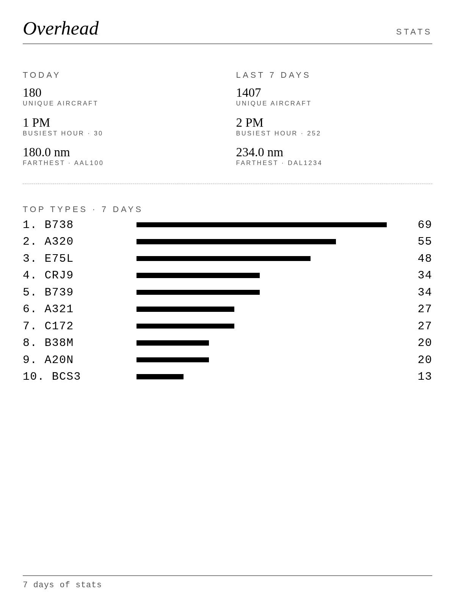

# Overhead: ADS-B line-drawing page


A single-file web page for a tar1090/readsb receiver that shows the aircraft above you as clean side-profile line drawings, sized for iPads and e-ink panels.

  

## Features

- Highest aircraft drawn large with callsign, airline, type, **route** (e.g. `EWR → TLV`), altitude, speed, distance and heading; the two nearest below it.
- 23 original aircraft drawings, picked from the ICAO type code.
- Faint background map (OpenStreetMap) plus your receiver's own coverage outline.
- **Recently seen** strip and an **Interesting this week** page (military, medevac, emergencies, rotorcraft, rare types).
- **Stats** page: unique aircraft, busiest hour, farthest contact (today and 7 days) and the top 10 types.
- **Night mode** (red on black after local sunset), **e-ink mode**, units (knots/ft, mph/mi, metric).
- Optional Pi logger with **ntfy push alerts**, and a nightly md5-verified **auto-update**.

| Live | Stats | Night |
|---|---|---|
|  |  |  |

All screenshots use `?demo=1` (invented aircraft and a synthetic map).

## Install (stock tar1090 Pi)

```sh
git clone https://github.com/ncklrs/aviation && cd aviation && sudo ./install.sh
# page only:            sudo NO_LOGGER=1 NO_TIMER=1 ./install.sh
```

This installs `overhead.html` into `/usr/local/share/tar1090/html/`, creates `html/ot/` (www-data) with `html/interesting.json` symlinked to `ot/interesting.json`, the logger as `interesting-logger.service`, and the nightly `overhead-update.timer`. Then open `http://<pi>/tar1090/overhead.html`. Set your receiver location in readsb so distances, the map and night mode work.

## Routes

Airline callsigns (e.g. `UAL88`) are looked up at [adsbdb.com](https://www.adsbdb.com/) (free, CORS-enabled). Results are cached per callsign for 24 h in localStorage, requests are spaced at least 4 s apart, and failures are silent. Routes come from crowd-sourced data and can be stale. Turn off with `?routes=0` or `OVERHEAD_CONFIG.routes=false`; `OVERHEAD_CONFIG.routeApi` changes the endpoint.

## Night mode

`?night=auto|on|off` (default `auto`, or `OVERHEAD_CONFIG.night`). In auto, sunrise and sunset are computed in the page from the home lat/lon (NOAA-style approximation, no API) and the page turns dim red on black between them. Ignored with `?eink=1`.

## Stats

The page keeps per-day counts in localStorage while it is open (unique ICAO hex, first-seen per hour, types, farthest contact; 8 days kept). The view rotation goes live → interesting this week → stats when `?cycle=` is at least 3× `weekSecs` (default 120 s / 20 s). Pin it with `?view=stats`. Counts only cover time the page was running.

## Push alerts (ntfy)

The logger can post to [ntfy](https://ntfy.sh). Off unless a topic is set. Put it in `/etc/default/interesting-logger` (template: `pi/interesting-logger.default`), never in the code:

```sh
NTFY_TOPIC=some-long-unguessable-name
#NTFY_SERVER=https://ntfy.sh
#NTFY_TAGS=Emergency,Hijack,Radio,Medevac,Military,Helicopter
```

`sudo systemctl restart interesting-logger`. At most one alert per aircraft per 6 h. Same options as flags: `--ntfy-topic`, `--ntfy-server`, `--ntfy-tags`.

## Auto-update

`pi/overhead-update.sh` (run nightly ~03:30 by `overhead-update.timer`) downloads `overhead.html`, `pi/interesting_logger.py` and `pi/interesting-logger.service` from `REPO_RAW` (default `https://raw.githubusercontent.com/ncklrs/aviation/main`), checks each against its published `.md5`, keeps a `.bak`, and swaps atomically only when the file changed and the md5 matches. It also re-creates `html/ot/` and the `interesting.json` symlink if missing. A new logger must pass `--selftest` before the service is restarted; otherwise the backup is restored. Override `REPO_RAW`, `PAGE_DIR`, `LOGGER` in `/etc/default/overhead-update`. Run now: `sudo systemctl start overhead-update; journalctl -u overhead-update`.

Maintainers: run `tools/release.sh` before every commit that touches those files; it runs the selftest and regenerates `overhead.html.md5`, `pi/interesting_logger.py.md5` and `pi/interesting-logger.service.md5`.

## Medevac detection

The logger tags **Medevac** from public, generic signals only: the tar1090 db operator (`ownOp`) naming an air-ambulance operator or hospital program (Air Methods, PHI, Metro Aviation, Med-Trans, Life Flight, CareFlight, Survival Flight, MedFlight, Air Evac, "medical", "hospital"…), or a rotorcraft (category A7 or helicopter type) using an air-ambulance callsign pattern (`LN#`, `LIFE`, `MERCY`, `CARE`, `STAT#`, `MEDEVAC`, `ANGEL`, …). Military aircraft (dbFlags) and `RCH` "Reach" callsigns stay Military. `python3 pi/interesting_logger.py --selftest` checks this.

## Logger stats, health and heat map

With the Pi logger running, it also writes, next to `interesting.json` in `html/ot/`:

- `stats.json` — every aircraft, not just the interesting ones: unique aircraft per day (8 days kept, 7-day unique total), new aircraft per hour, farthest contact with type and callsign, a top-types tally, and a message-rate sample every 5 minutes for 24 h. The stats view uses it when present and falls back to the browser's own log.
- `health` inside `stats.json` — after `QUIET_MINUTES` (default 15) with 0 aircraft or under `MIN_MSG_RATE` msg/s (default 1), the logger sends one "receiver quiet" ntfy alert, then one "recovered". The page footer shows a red dot when the receiver is quiet or the logger output is more than 10 minutes old.
- `heat.json` — a coarse 1 km grid of **offsets from the receiver** (east/north cell numbers, never coordinates), fading with a 7-day half-life, capped at 30,000 cells within 400 km. `?view=heat` shows it as dot density (fine on e-ink); `?heat=1` adds it to the rotation after stats. `?heatKm=120` sets the radius.

All three are written atomically (temp file + rename) and stay bounded in size. `--no-stats` turns them off.

## Weekly digest

`overhead-digest.timer` runs Sundays at 09:00 and posts a short summary (unique aircraft, busiest day, farthest contact, top types, interesting sightings) to the same `NTFY_TOPIC`. With no topic it does nothing. Try it: `python3 /usr/local/bin/overhead-digest.py --dry-run`.

## Airframe photos

The featured live card shows a small photo from [Planespotters.net](https://www.planespotters.net/photo/api) with the photographer credit and a link to the photo page, per their API terms (lookups cached up to 24 h, images never stored). **Off by default.** Turn it on with `?photos=1` or `photos: true` in `OVERHEAD_CONFIG`; `?photos=0` always forces it off. Never shown in e-ink mode.

## Sound

`?sound=1` plays a short synthesized chime (no audio files) when an Emergency, Medevac, Military or rotorcraft contact is in view, at most once per aircraft per 30 minutes. Browsers, and iOS especially, keep audio locked until you tap the page, so a "tap to enable sound" button shows until then. Off by default.

## Hangar (plane trading cards)

`?view=cards` shows your collection: one card per aircraft type ever seen, with its line drawing, type code, rarity badge, first-spotted date, sightings (passes 30+ min apart), distinct tails and closest pass. `?cards=1` adds the Hangar to the rotation and shows a **NEW CARD!** banner on the live view for 30 minutes after a new type turns up. The top bar shows types, tails, progress against a built-in checklist of ~180 types, and a count per tier. With more than 9 cards the grid pages by itself (`?page=N` pins one).

Rarity runs Common → Uncommon → Rare → Epic → Legendary:
- **Legendary** comes from a fixed list: V-22, Chinook, B-52, U-2, E-4/E-6, VC-25, An-124/225, Beluga, warbirds and others.
- **Epic** covers any military or rotorcraft type plus a list of fighters, tankers and transports.
- Everything else depends on how often you see it. A type with 25+ distinct tails is Common. Types on the common GA/airliner list are Common at 8+ tails. Any other type is Uncommon at 8+ tails, otherwise Rare.

Rare and above get line-hatching "holo" (one direction for Rare, crosshatch for Epic, triple for Legendary), which stays pure black and white on e-ink.

The Pi logger keeps `ot/collection.json`. It holds only types, tails (registrations, which are public aircraft data), counts, dates and the closest-pass distance. No positions. Without it the page keeps a smaller collection in this browser's localStorage. Turn the logger part off with `--no-collection`.

## Sky radio

`?radio=1` turns the sky into slow ambient music, synthesized live with WebAudio (no audio files). It is off by default, and browsers (iOS especially) need one tap: a "tap to tune in" pill shows until then, then "ON AIR · N voices". Each of the nearest 10 aircraft is a voice:
- **Pitch** follows altitude on a pentatonic scale.
- **Volume** follows distance (silent past 80 nm).
- **Pan** follows bearing and drifts slowly.
- **Timbre** depends on the kind of aircraft:
  - GA and props: soft sine plucks.
  - Jets: long airy pads.
  - Helicopters: a low rumble pulsed at a rotor-ish rate (slower for a Chinook).
  - Military: a mellow brass swell.

Notes fall on a slow 0.8 s clock, each voice on its own period. `?vol=0..1` (or 0–100) sets master volume (default 0.6). After dark (sunset to sunrise at the receiver) the radio fades out over about a minute; `?radio=night` keeps it playing. Always off with `eink=1`. `sample-sky-radio.wav` is 20 s of the demo sky, rendered offline.

## Daily sky poster

`pi/overhead-poster.py` runs nightly at 23:55 (`overhead-poster.timer`) and draws that day's flight tracks as thin line art on cream paper:
- Rarer types get heavier lines.
- The bottom strip shows the day's best sightings, drawn with the page's own drawings.
- The title is the date, with a stats line under it.

There's no map, no place names and no coordinates. The logger stores tracks only as east/north offsets in km from the receiver (`ot/.tracks/`, kept 3 days), and the poster is fitted to the tracks' own extent. Posters go to `ot/posters/YYYY-MM-DD.svg` with an `index.json`, and 365 days are kept. Stdlib only. `--demo --out x.svg` draws a synthetic day, `--selftest` checks it.

`?view=poster` shows the latest poster (`&poster=YYYY-MM-DD` for a given day). `?view=posters` is the archive grid; tap a thumbnail to open it. In `eink=1` the poster turns black on white.

## Notes

`index.html` is one self-contained file (no external assets). Thin black strokes on white,
legible on B/W or 16-grey e-ink at 800x480, 1200x1600 (portrait stacks) and 1872x1404.

- **Up high**: highest aircraft at or above 18,000 ft, drawn large and rotated to its track, with callsign, FL, ground speed, distance and heading.
- **The pattern**: up to 5 nearest aircraft below 18,000 ft. Category A1 or unknown gets a high-wing Cessna drawing, A2 a bizjet, A3 to A6 an airliner, and A7 a helicopter.
- Empty states read "Quiet skies" or "Nothing up high". The footer shows the count and the time the data was updated.
- Config constants sit at the top of the `<script>` block: `AIRCRAFT_URL` (default `http://pi.local:8080/data/aircraft.json`), `HIGH_FT`, `MAX_PATTERN`, `MAX_SEEN_S`, and an optional `HOME`. `receiver.json` is read from the same folder to get the lat/lon used for distance.
- URL params: `?demo=1` (uses the fake `sample-aircraft.json` / `sample-receiver.json`, with an inline copy as fallback), `?url=…`, `?receiver=…`, `?refresh=SECONDS` (standalone only).

## Caveats
- **Refresh**: e-ink renders once per device refresh. A refresh of 2 to 5 minutes is reasonable, so planes will be a snapshot, not live. Each refresh costs battery.
- **CORS**: if you open the page from a different origin (for example `file://` or another host), the browser needs the Pi to send `Access-Control-Allow-Origin`. Serving the page from the Pi avoids this.
- `category` is often missing for small GA transponders. Those default to the Cessna drawing, or the airliner if they're above 18,000 ft.
- `receiver.json` only has lat/lon if you set a location in readsb/dump1090. Otherwise set `HOME`, or distances show "—".
- The demo data is entirely fake (DEMO101, N0FAKE1, and so on).

Previews: `preview-800x480.png`, `preview-1200x1600.png`, `preview-1872x1404.png`.

## URL parameters

| Param | Default | Meaning |
|---|---|---|
| `demo=1` | off | Fake aircraft, synthetic map, fake weekly entries |
| `refresh=N` | 0 | Re-poll every N seconds (0 = render once) |
| `lat=` `lon=` | receiver.json | Map center if receiver.json has no position |
| `map=0` / `mapNm=N` / `overpass=URL` | on / 25 / public | Background OSM line map |
| `cycle=N` | 120 | Seconds per live/weekly cycle; `cycle=0` never shows the weekly page |
| `weekSecs=N` | 20 | Seconds the weekly page shows in each cycle |
| `view=week` / `live` / `stats` / `heat` / `cards` / `poster` / `posters` | | Pin one view (screenshots) |
| `cards=1` / `page=N` | off | Hangar in the rotation + NEW CARD banner / pin a page of cards or posters |
| `poster=YYYY-MM-DD` | latest | Which poster `view=poster` shows |
| `radio=1` / `radio=night` / `vol=0..1` | off / / 0.6 | Sky radio / keep playing after dark / master volume |
| `heat=1` / `heatKm=N` | off / 120 | Add the heat map to the rotation (needs `cycle` ≥ 4 × `weekSecs`) / its radius in km |
| `photos=1` / `photos=0` | off | Show / force off the Planespotters.net photo (always off with `eink=1`) |
| `sound=1` | off | Chime for Emergency / Medevac / Military / rotorcraft, once per aircraft per 30 min |
| `interesting=URL` | auto | Logger output location (tries `data/interesting.json`, then `interesting.json` next to the page) |
| `units=aero\|imperial\|metric` | `aero` | aero: kt / ft (FL above `upHighFt`) / nm · imperial: mph / ft / mi · metric: km/h / m / km |
| `eink=1` | off | Strict 1-bit black and white, no motion, thicker strokes; refresh defaults to 60 s |
| `recent=0` | on | Hide the "Recently seen" strip |
| `url=URL` / `receiver=URL` | `data/aircraft.json` / alongside | Receiver data sources |
| `upHighFt=N` | 18000 | "Up high" threshold |

The cycle is clock-based (`now mod cycle < weekSecs`), so render-once snapshots also land on the weekly page for the same share of runs.

## Configuration

No code edits needed. Settings resolve in this order: **URL param → `window.OVERHEAD_CONFIG` → constants at the top of the script**.

Option 1, URL params (see table above), e.g. `overhead.html?units=metric&eink=1&refresh=60`.

Option 2, a config block. Put this in a `<script>` placed *before* the main script (or in a `config.js` you include there):

```html
<script>
window.OVERHEAD_CONFIG = {
  aircraftUrl:    'data/aircraft.json',   // readsb/tar1090 aircraft.json
  receiverUrl:    null,                   // default: receiver.json next to aircraft.json
  interestingUrl: null,                   // default: auto (see below)
  home:           null,                   // {lat: 0.0, lon: 0.0}; null = use receiver.json position
  units:          'aero',                 // 'aero' | 'imperial' | 'metric'
  eink:           false,
  refresh:        0,                      // seconds; 0 = render once (eink defaults to 60)
  recent:         true,                   // "Recently seen" strip
  photos:         false                   // Planespotters.net photo; off by default (?photos=1 / ?photos=0 override)
};
</script>
```

Home position: if `home` is null the page uses the lat/lon in `receiver.json`. Nothing about your location is stored in the code. `?lat=&lon=` override both. Without any position, distances show "—" and the map is skipped.

Try it with `?demo=1` (fake aircraft around an arbitrary demo point, synthetic map).

## E-ink mode

`?eink=1` turns every grey into black, uses dotted black lines for the map, thickens the line drawings, disables transitions and animations, and re-polls every 60 s (override with `refresh=`). For panels that do a full refresh per render, `refresh=0` renders once and leaves the refresh to your screenshot tool.

## Recently seen strip

A one-line strip above the footer listing the newest military, rotorcraft (incl. Chinook, Osprey), medevac and emergency aircraft from the last 7 days, e.g. `RCH431 C17 · Military · 5h`. It comes from the logger's `interesting.json`, or the page's own localStorage log if there's no logger. It's hidden when there is nothing to show, during the weekly page, or with `recent=0`. Its tag priority is Emergency > Medevac > Military > Helicopter > Rare type. Medevac detection is best effort (see Medevac detection).

## "Interesting this week"

An aircraft is logged when any of these is true:

- dbFlags military (bit 1), interesting (bit 2), PIA (bit 4) or LADD (bit 8)
- squawk 7500, 7600 or 7700, or an emergency status
- helicopter (category A7 or known rotorcraft type)
- widebody or four-engine type
- above 45,000 ft or faster than 550 kt ground speed
- a type not on the built-in common list (C172, PA28, 737, A320, CRJ and so on)

The weekly page shows up to 8 entries: emergencies first, then military, PIA/LADD, flagged, then the rest, newest first within each group.

Without the logger the page keeps its own 7-day log in localStorage, which only covers time the page was open.

### Optional Pi-side logger

`install.sh` sets this up for you; the manual steps are below.

`pi/interesting_logger.py` is one Python 3 script, stdlib only. It polls aircraft.json every 30 s, dedupes by ICAO hex per UTC day (keeping first/last seen, max altitude, max speed) and atomically writes a rolling 7-day `html/ot/interesting.json`; `html/interesting.json` is a symlink to it, so only `ot/` is writable by www-data (the html folder itself is never chowned).

```sh
sudo install -m 755 pi/interesting_logger.py /usr/local/bin/
H=/usr/local/share/tar1090/html
sudo install -d -o www-data -m 755 $H/ot                    # the logger only writes here (temp file + rename)
sudo ln -sfn ot/interesting.json $H/interesting.json         # page still finds interesting.json next to itself
sudo -u www-data python3 /usr/local/bin/interesting_logger.py --once --out $H/ot/interesting.json && echo ok
```

As a service:

```sh
sudo cp pi/interesting-logger.service /etc/systemd/system/
sudo systemctl daemon-reload && sudo systemctl enable --now interesting-logger
journalctl -u interesting-logger -f
```

Or cron instead (`pi/crontab.example`):

```
* * * * * /usr/bin/python3 /usr/local/bin/interesting_logger.py --once
```

Options: `--selftest`, `--ntfy-topic/--ntfy-server/--ntfy-tags`, `--src` (URL or file, e.g. `/run/readsb/aircraft.json`), `--out`, `--interval`, `--max-seen`, `--once`. The page looks for `data/interesting.json` and then `interesting.json` next to itself, so the default `--out` works with no settings. Anywhere else: `?interesting=URL`. Check with `curl -s http://localhost/tar1090/interesting.json | head -c 300`. Remove with `sudo systemctl disable --now interesting-logger`.

## Credits

See `CREDITS.md`: original drawings, map data © OpenStreetMap contributors (ODbL), routes from adsbdb.com. Licensed MIT (`LICENSE`).

### New-card reveal
When a new aircraft type is unlocked (the NEW CARD banner trigger), a full-screen Pokémon-style reveal plays over any view: face-down card back → 3D spin → holo shine, rarity glow and particle burst → hold → shrink into the Hangar. It's on by default.
- `reveal=0` turns it off. `reveal=static` (or `eink=1`, or the OS reduced-motion setting) shows a static card with no motion.
- `demo=reveal` plays it with demo data. `revealT=V22` picks the type, `revealN=3` queues several, and `revealHold=1` keeps it on screen.
- Queue cap is 5, at most 3 per poll; unlocks older than 30 min aren't replayed. There's a short chime when sound or radio is on.
